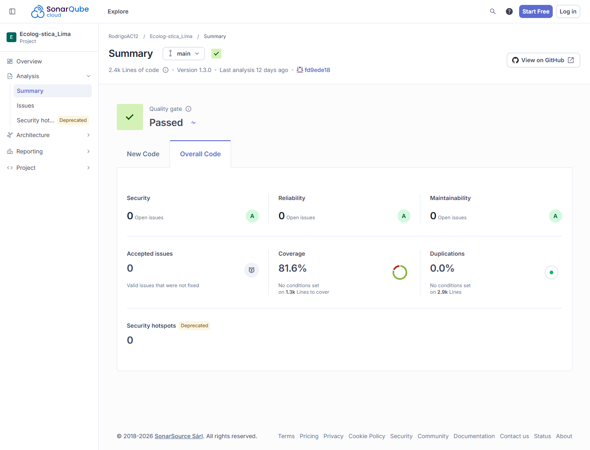

[← Volver al README](../../../README.md)

# Evaluación de Calidad de Código — SonarQube

**Nombre del Proyecto:** EcoLogística Lima 
**Fecha de Análisis:** 27/10/2026, 19:27:13 (America/Lima) 
**Versión del Análisis:** V_1_0_0 
**Herramienta:** SonarQube Cloud (SonarCloud) 
**Proyecto:** `RodrigoAC12_Ecolog-stica_Lima` 
**Rama:** `main` 
**Revisión analizada:** `fd9ede188207982af68af7b9ef014005f6135bec`

## 1. Resumen Ejecutivo de Quality Gate

- **Estado del Quality Gate:** PASSED.
- **Porcentaje de Cobertura de Pruebas:** 81.6% global; 92.9% sobre código nuevo.
- **Cobertura de líneas:** 80.5%.
- **Cobertura de condiciones:** 89.4%.
- **Duplicación de Código:** 0.0%.
- **Líneas de código analizadas:** 2,379.

La captura procede del panel público del proyecto y corresponde a la revisión indicada. Los cambios locales posteriores no forman parte de estas métricas hasta que se ejecuta un nuevo análisis.

## 2. Métricas Principales

| Categoría | Cantidad Detectada | Severidad |
|---|---:|---|
| Bugs / Reliability issues | 0 | Sin hallazgos abiertos |
| Vulnerabilidades / Security issues | 0 | Sin hallazgos abiertos |
| Code Smells / Maintainability issues | 0 | Sin hallazgos abiertos |
| Security Hotspots | 0 | Sin hotspots pendientes |

SonarCloud muestra calificación **A** en seguridad, fiabilidad y mantenibilidad para el código global analizado. La API pública del proyecto devuelve `sqale_index = 0` minutos y una proporción de deuda técnica de `0.0%` para esta revisión.

## 3. Plan de Remediación y Deuda Técnica

- **Deuda Técnica Estimada por SonarCloud:** 0 minutos en la revisión analizada.
- **Hallazgos abiertos:** ninguno.
- **Acciones preventivas:**
  1. Mantener la cobertura global por encima del umbral del Quality Gate.
  2. Ejecutar pruebas y SonarCloud antes de integrar cambios nuevos.
  3. No reducir cobertura o duplicación mediante exclusiones sin justificación.
  4. Repetir el análisis cuando cambie el código fuente y conservar el commit exacto.

## 4. Alcance frente a requisitos no funcionales

SonarCloud analiza calidad y seguridad estática; no mide la disponibilidad de un servicio desplegado ni sustituye pruebas de carga. El estado comprobable es:

| Requisito | ¿SonarCloud lo demuestra? | Resultado real disponible |
|---|---|---|
| Generación de rutas ≤45 s | No | No evaluado por este análisis de SonarCloud |
| Reoptimización <30 s | No | No evaluado por este análisis de SonarCloud |
| Disponibilidad mensual ≥99.5% entre 05:00 y 22:00 | No | **No demostrada:** no existe una ventana mensual de monitoreo en SonarCloud |
| Recuperación del servicio ≤10 min | No | **No demostrada:** requiere provocar y medir una interrupción recuperable |
| 1,000 pedidos, 50 vehículos y CPU <80% | No | **No demostrada por SonarCloud:** requiere prueba de carga y telemetría de CPU |
| Seguridad de código | Parcialmente | Gate aprobado, calificación A, 0 vulnerabilidades y 0 hotspots en el alcance analizado |
| Accesibilidad y navegadores | No | Se evalúa por separado en el informe WCAG |
| Integridad transaccional y auditoría | No directamente | Requiere pruebas funcionales de rollback y registro de auditoría |
| Latencia P95 ≤2 s | No | **No demostrada por SonarCloud:** requiere medición bajo carga objetivo |
| Pruebas automatizadas | Parcialmente | Cobertura importada: 81.6% global y 92.9% en código nuevo |

Por tanto, el 99.5% de disponibilidad y los demás umbrales operativos no deben marcarse como cumplidos usando esta captura. Deben permanecer pendientes hasta contar con sus mediciones específicas.

[← Volver al README](../../../README.md)
