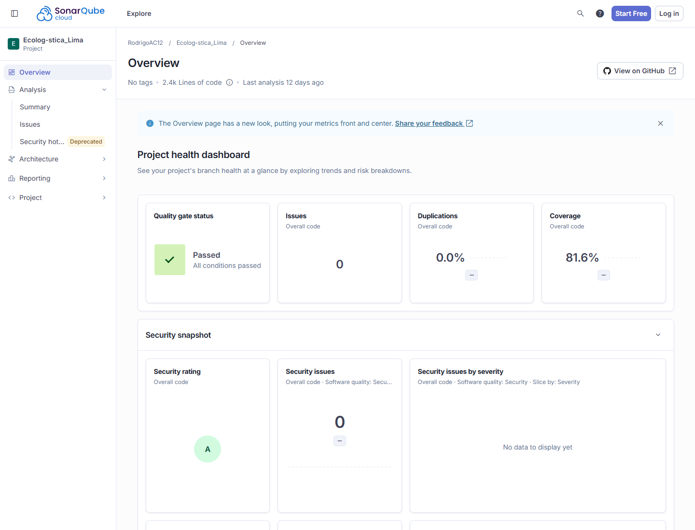

[← Volver al README](../../../README.md)

# Reporte de Seguridad OWASP Top 10 (2025)

**Nombre del Proyecto:** EcoLogística Lima 
**Herramienta de Escaneo:** SonarQube Cloud (SonarCloud) 
**Versión del documento:** V_1_0_0 
**Revisión analizada:** `fd9ede188207982af68af7b9ef014005f6135bec`

## 1. Matriz de Cumplimiento OWASP Top 10 2025

| Categoría OWASP 2025 solicitada en la consigna | Estado en Proyecto | Hallazgos de SonarQube |
|---|---|---|
| A01:2025 — Broken Access Control | Bajo revisión | 0 hallazgos estáticos; existen controles de autenticación y autorización, pero SonarCloud no sustituye una prueba completa por roles y objetos |
| A02:2025 — Cryptographic Failures | Bajo revisión | 0 hallazgos; la configuración TLS y la gestión de secretos deben validarse en el entorno desplegado |
| A03:2025 — Injection | Sin hallazgos en el alcance analizado | 0 hallazgos abiertos; el backend utiliza ORM y validación de entradas |
| A04:2025 — Insecure Design | Bajo revisión | 0 hallazgos; requiere revisión de arquitectura y abuso, no solo análisis estático |
| A05:2025 — Security Misconfiguration | Bajo revisión | 0 hallazgos; falta validar de forma independiente la configuración del despliegue final |
| A06:2025 — Vulnerable and Outdated Components | Bajo revisión | 0 vulnerabilidades reportadas por SonarCloud; debe complementarse con auditoría de dependencias |
| A07:2025 — Identification and Authentication Failures | Sin hallazgos en el alcance analizado | 0 hallazgos; autenticación JWT y rechazo de acceso no autorizado cubiertos por pruebas del proyecto |
| A08:2025 — Software and Data Integrity Failures | Bajo revisión | 0 hallazgos; migraciones, transacciones y cadena de suministro necesitan comprobaciones complementarias |
| A09:2025 — Security Logging and Monitoring Failures | Bajo revisión | 0 hallazgos; el registro de auditoría existe, pero no se ha demostrado monitoreo operativo centralizado |
| A10:2025 — Server-Side Request Forgery (SSRF) | Sin hallazgos en el alcance analizado | 0 hallazgos y no se identificaron endpoints del backend que acepten una URL arbitraria para solicitar recursos |

“Sin hallazgos” significa que SonarCloud no abrió problemas para la revisión analizada; no equivale a una certificación total de la categoría OWASP.

## 2. Detalles de Security Hotspots y Vulnerabilidades Críticas

- **Security Hotspots abiertos:** 0.
- **Vulnerabilidades abiertas:** 0.
- **Security issues:** 0.
- **Calificación de seguridad:** A.
- **Hotspot #1:** no aplica; no existen hotspots pendientes.
- **Hotspot #2:** no aplica; no existen hotspots pendientes.

No se registraron correcciones de hotspots porque el análisis no generó ninguno. Las categorías marcadas “Bajo revisión” requieren pruebas dinámicas, configuración o revisión manual que quedan fuera de lo que SonarCloud demuestra.

[← Volver al README](../../../README.md)
