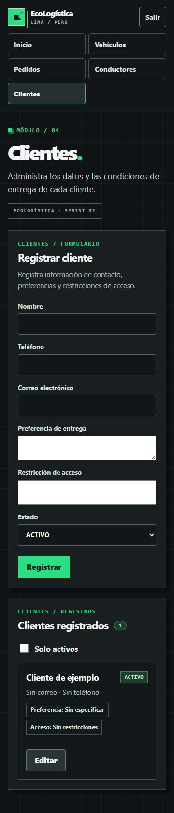
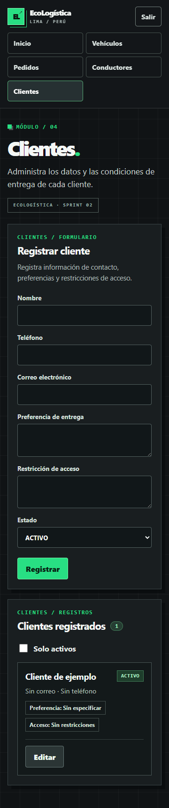

[← Volver al README](../../../README.md)

# Evaluación de Accesibilidad Web (WCAG)

**Nombre del Proyecto:** EcoLogística Lima 
**Nivel de Conformidad Objetivo:** WCAG 2.2 Nivel AA, ampliando la línea base WCAG 2.1 AA del proyecto. 
**Herramientas Utilizadas:** axe-core mediante `@axe-core/playwright` 4.14.0, Playwright 1.64.1 y Microsoft Edge en un contexto aislado. 
**Versión documental:** V_1_0_0. 
**Fecha:** 24/10/2026 (Lima). 
**Alcance:** login, inicio, vehículos, pedidos, conductores, clientes y error de autenticación. API real FastAPI con SQLite exclusivo de auditoría y datos sintéticos.

## 1. Resumen de Accesibilidad por Principios

| Principio | Resultado observado | Comprobación pendiente |
|---|---|---|
| **Perceptible** | Sin infracciones automáticas en los estados examinados. Las capturas muestran contenido legible y sin desbordamiento a 360 px. | axe deja incompleta la evaluación de contraste sobre fondos con imágenes o gradientes; verificar esos elementos y contraste en todos sus estados. |
| **Operable** | Enlace de salto accesible por Tab y activable por Enter. Se corrigió la gestión del foco después del login y de cambiar de vista. Las comprobaciones de reflow pasan. | Validación por personas con lector de pantalla, recorridos completos con teclado y navegadores soportados. |
| **Comprensible** | Formularios etiquetados, errores de autenticación anunciados con `role="alert"` y mensajes de estado existentes. | Evaluar comprensión con usuarios y todos los errores de negocio; el estado de error de login no cubre todos los escenarios posibles. |
| **Robusto** | axe no notifica infracciones de las reglas A/AA seleccionadas en los estados examinados. Se usa HTML semántico y React. | Probar combinaciones reales de navegador y tecnología de asistencia; no basta el motor Chromium de una versión. |

No se asigna un porcentaje global de conformidad WCAG: no existe un denominador de criterios completamente evaluados que lo sustente. Cero infracciones automáticas no equivale a 100 % de cumplimiento. La [metodología W3C](https://www.w3.org/WAI/test-evaluate/tools/selecting/) requiere juicio humano para aspectos que las herramientas no pueden resolver; los criterios se consultan en [WCAG 2.2](https://www.w3.org/TR/WCAG22/).

### Ejecuciones y alcance reproducible

| Comprobación | Antes de corregir | Después de corregir |
|---|---:|---:|
| Estados analizados | 13 | 13 |
| Infracciones automáticas axe | 0 | 0 |
| Comprobaciones dirigidas de interacción | 11 | 11 |
| Comprobaciones de interacción fallidas | 6 | 0 |
| Desbordamientos horizontales en los estados medidos | 0 | 0 |

Cada una de las seis pantallas principales se examinó a 1.440 y 360 px; se añadió el estado de login fallido a 360 px. Además se comprobó reflow de clientes a 320 px. Las seis fallas de interacción iniciales correspondían a una misma causa: el foco no se movía al contenido después de autenticarse o de utilizar los cinco destinos de navegación. Son comprobaciones dirigidas de navegación, no seis infracciones automáticas distintas.

Los resultados completos, versiones y selectores pendientes están en [evaluación inicial](evidencias/accesibilidad-inicial.json) y [evaluación posterior](evidencias/accesibilidad-final.json). Para reproducir: instalar dependencias y ejecutar `npm run audit:accessibility -- actual` desde `src/frontend/`. El [script](../../../scripts/audit_accessibility.mjs) prepara una base aislada, inicia procesos propios en 8003/5175 y los detiene al terminar. No utiliza sesiones personales ni las bases existentes.

## 2. Hallazgos Principales y Correcciones

| Criterio de conformidad relacionado | Problema detectado | Componente afectado | Solución aplicada y verificación |
|---|---|---|---|
| **2.4.3 Orden del foco** | Al cambiar de vista, el foco permanecía en la navegación; seis comprobaciones de la experiencia prevista fallaban. | `App.tsx`, login y navegación principal | Se enfoca `main-content` al cambiar sesión/vista y al seleccionar la vista actual. Las seis comprobaciones pasan y se añade una prueba de regresión. |
| **2.4.7 Foco visible** | Los controles multilínea no compartían el patrón explícito de foco y presentación de los demás campos. | `styles/forms.css`, formularios de clientes | Se incluyen `textarea` en los estilos de controles y se define contorno `focus-visible` para input/select/textarea. Se inspecciona la captura y se conserva la comprobación de foco del formulario. Es una mejora preventiva, no una infracción notificada por axe. |
| **1.4.10 Reflow** | Riesgo revisado de pérdida de contenido en pantallas estrechas. | Seis pantallas y clientes a 320 px | No se detectó desbordamiento en las dimensiones probadas. Se conservan resultados y capturas; el hallazgo no requiere una corrección de layout. |
| **1.4.3 Contraste mínimo** | La herramienta deja evaluaciones incompletas sobre determinados fondos e imágenes. | Selectores identificados por pantalla en los JSON | No se da por corregido ni aprobado automáticamente. Pendiente revisión específica de contraste y estados. |
| **3.3.1 Identificación de errores / 4.1.3 Mensajes de estado** | Se verifica el anuncio de una respuesta de credenciales incorrectas. | Login y componente `StatusMessage` | El error se presenta como alerta visible. Comprobación aprobada; ampliar a los errores de los demás flujos. |

### Evidencia visual

Antes y después del ajuste de controles en clientes a 360 px:

Las capturas complementan las pruebas, pero no sustituyen la medición de contraste ni el uso de tecnologías de asistencia. La evaluación no declara todavía conformidad completa AA; los pendientes se conservan para revisión del equipo y del DoD.

## Control documental

| Versión | Fecha | Cambio |
|---|---|---|
| V_1_0_0 | 24/10/2026 | Evaluación de 13 estados, corrección del foco y controles multilínea, evidencias antes/después y límites de conformidad. |

[← Volver al README](../../../README.md)
