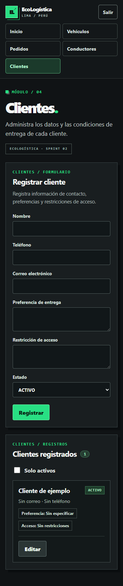

[← Volver al README](../../../README.md)

# Evaluación de Accesibilidad Web (WCAG)

**Nombre del Proyecto:** EcoLogística Lima 
**Nivel de Conformidad Objetivo:** WCAG 2.2 Nivel AA, ampliando la línea base WCAG 2.1 AA del proyecto. 
**Herramientas Utilizadas:** axe-core mediante `@axe-core/playwright` 4.14.0, Playwright 1.64.1 y Microsoft Edge en un contexto aislado; ampliación con Selenium WebDriver y seis versiones de Chrome, Edge y Firefox. 
**Versión documental:** V_1_0_4 · **Versión del proyecto:** 1.3.0. 
**Fecha:** 25/10/2026 (Lima). 
**Alcance:** login, inicio, vehículos, pedidos, conductores, clientes y error de autenticación. API real FastAPI con SQLite exclusivo de auditoría y datos sintéticos.

## 1. Resumen de Accesibilidad por Principios

El alcance de despliegue es localhost, según la [adenda del 25/10/2026](<Alcance de validación local V_1_0_0.md>). Las comprobaciones conservan sus resultados y límites; no se exige acceso desde infraestructura remota.

| Principio | Resultado observado | Comprobación pendiente |
|---|---|---|
| **Perceptible** | 437 comprobaciones de contraste de texto aprobadas en 13 estados; ratio mínimo medido 6,66:1. Cero resultados de contraste incompletos sobre contenido funcional. | Evaluar estados adicionales y otras combinaciones de navegador/tecnología de asistencia; no extrapolar a toda la interfaz futura. |
| **Operable** | Enlace de salto por Tab/Enter, cambio de vista mediante teclado, foco dirigido y recorrido Tab completo de los cinco formularios con indicador visible. 16 comprobaciones dirigidas y reflow aprobados. | Revisión del cliente o del usuario con lector de pantalla; matriz técnica de seis versiones completada. |
| **Comprensible** | Formularios etiquetados, errores de autenticación anunciados con `role="alert"` y mensajes de estado existentes. | Evaluar comprensión con usuarios y todos los errores de negocio; el estado de error de login no cubre todos los escenarios posibles. |
| **Robusto** | axe no notifica infracciones A/AA en Microsoft Edge 152.0.4191.66. Los inputs están etiquetados y las alertas del login son identificables por su rol. | Matriz técnica de dos versiones por navegador completada; comprensión con lector de pantalla en revisión del cliente o del usuario. |

No se asigna un porcentaje global de conformidad WCAG: no existe un denominador de criterios completamente evaluados que lo sustente. Cero infracciones automáticas no equivale a 100 % de cumplimiento. La [metodología W3C](https://www.w3.org/WAI/test-evaluate/tools/selecting/) requiere criterio profesional para aspectos que las herramientas no pueden resolver; los criterios se consultan en [WCAG 2.2](https://www.w3.org/TR/WCAG22/).

### Ejecuciones y alcance reproducible

| Comprobación | Inicial, 24/10 | Foco corregido, 24/10 | Entrega, 25/10 |
|---|---:|---:|---:|
| Estados analizados | 13 | 13 | 13 |
| Infracciones automáticas axe | 0 | 0 | 0 |
| Comprobaciones dirigidas de interacción | 11 | 11 | 16 |
| Comprobaciones de interacción fallidas | 6 | 0 | 0 |
| Desbordamientos horizontales en los estados medidos | 0 | 0 | 0 |
| Resultados incompletos sobre contenido funcional | Contraste pendiente | Contraste pendiente | 0 |

Cada una de las seis pantallas principales se examinó a 1.440 y 360 px; se añadió el estado de login fallido a 360 px. Además se comprobó reflow de clientes a 320 px. Las seis fallas de interacción iniciales correspondían a una misma causa: el foco no se movía al contenido después de autenticarse o de utilizar los cinco destinos de navegación. Son comprobaciones dirigidas de navegación, no seis infracciones automáticas distintas.

Los resultados, ratios, colores, tamaños de fuente y controles recorridos de la versión 1.3.0 están en la [evaluación actual](evidencias/accesibilidad-demostracion-1-3-0.json). Se conservan la [evaluación inicial](evidencias/accesibilidad-inicial.json), el [corte posterior del foco](evidencias/accesibilidad-final.json) y el [primer corte de contraste](evidencias/accesibilidad-entrega-edge.json). Para reproducir con grabación: instalar dependencias y ejecutar `npm run audit:accessibility -- demostracion-1-3-0 edge demo` desde `src/frontend/`. El [script](../../../scripts/audit_accessibility.mjs) prepara una base aislada, inicia procesos propios en 8003/5175 y los detiene al terminar. No utiliza sesiones personales ni las bases existentes. Termina con error si detecta infracciones, fallos de interacción/reflow o resultados incompletos no decorativos.

La ejecución incorpora además once operaciones funcionales sobre las quince historias existentes, con mensajes de resultado comprobados. El [video](evidencias/demostracion-1.3.0.webm) y las capturas de registro, edición, desactivación y cancelación complementan la evaluación del principio Comprensible; no sustituyen el evaluación del lector de pantalla por el cliente o el usuario ni la aceptación funcional.

Se eliminaron las imágenes de fondo superpuestas al texto y se hizo opaca la barra de navegación para permitir una medición reproducible. Las 437 comprobaciones son ocurrencias entre pantallas y tamaños, no 437 criterios WCAG ni elementos únicos. El mínimo corresponde al texto del pie de login, color `#91a8a0` sobre `#191e20` (6,66:1 frente a 4,5:1 requerido). Quedan 13 ocurrencias incompletas de elementos decorativos —flechas redundantes y emblema— dentro de `aria-hidden="true"`; se identifican individualmente en el JSON y no contienen información exclusiva ni sustituyen el nombre de un control.

El intento anterior con Firefox 157.0 de Playwright no pudo iniciarse; se conserva ese antecedente. La ampliación posterior utiliza las versiones estables oficiales 157.0.1 y 158.0.1 mediante GeckoDriver, con resultados identificados en la matriz siguiente.

### Matriz ampliada de compatibilidad — 25/10/2026

La [evidencia consolidada](evidencias/compatibilidad-1.3.0.json) recoge **seis versiones de tres navegadores**, seleccionadas a partir de los canales y catálogos oficiales. Chrome utiliza los binarios oficiales Chrome for Testing; Firefox y Edge anteriores se ejecutan desde directorios aislados, sin sustituir los navegadores personales. Selenium WebDriver, ChromeDriver, EdgeDriver y GeckoDriver controlan sesiones nuevas en Windows.

| Navegador | Versión ejecutada | Estados | Comprobaciones | Resultado |
|---|---|---:|---:|---|
| chrome | 156.0.8078.47 | 13 | 84 | Aprobado |
| chrome | 155.0.8059.84 | 13 | 84 | Aprobado |
| MicrosoftEdge | 156.0.4314.42 | 13 | 84 | Aprobado |
| firefox | 158.0.1 | 13 | 84 | Aprobado |
| firefox | 157.0.1 | 13 | 84 | Aprobado |
| MicrosoftEdge | 155.0.4283.62 | 13 | 84 | Aprobado |

Se comprueban login, inicio, los cuatro módulos y error de autenticación, a 1.440/360 px según cada estado: **78 estados**, **504 comprobaciones** y **3.258 ocurrencias de contraste** en total, sin infracciones automáticas ni desbordamientos en los estados aprobados. Las comprobaciones incluyen nombres de campos, región principal, idioma, salto al contenido, foco, mensajes y operaciones de las quince historias. Son ocurrencias repetidas de verificación, no 504 criterios WCAG distintos ni una puntuación de conformidad.

El JSON identifica las ejecuciones: cinco versiones aprobaron en el recorrido conjunto final y Chrome 155 se repitió con espera explícita del fin de envío y de actualización del listado, aprobando sus 84 comprobaciones. Se conserva el [corte anterior](evidencias/compatibilidad-antes-lecturas.json) y no se presenta la consolidación como una única ejecución sin reintentos. Los archivos fuente se identifican mediante SHA-256.

Al ampliar navegadores se observó una superposición del adorno de Inicio a 360 px que dejaba el contraste del párrafo sin evaluar. Se oculta ese elemento decorativo a 600 px o menos; los estados finales evalúan el contraste funcional. La API del frontend pide `cache: 'no-store'` como medida preventiva para obtener respuestas frescas; no se atribuye al caché una causa de fallo confirmada. El procedimiento y sus recursos figuran en la [guía de compatibilidad](<../../Calidad/04 Compatibilidad de navegadores.md>).

**Lector de pantalla:** se preparó NVDA 2026.2 portátil en un directorio temporal, pero la herramienta de control de Windows interrumpió la comprobación al no poder verificar con certeza la URL del navegador. No se acredita una prueba aprobada de lector de pantalla ni una evaluación de comprensión. Queda en **revisión del cliente o del usuario**, a cargo de Luis Antony Gonzalo Guerrero, con coordinación de Marco Jhair Martinez Llanos. Las herramientas aisladas y sus perfiles no se publican como evidencia de aceptación.

## 2. Hallazgos Principales y Correcciones

| Criterio de conformidad relacionado | Problema detectado | Componente afectado | Solución aplicada y verificación |
|---|---|---|---|
| **2.4.3 Orden del foco** | Al cambiar de vista, el foco permanecía en la navegación; seis comprobaciones de la experiencia prevista fallaban. | `App.tsx`, login y navegación principal | Se enfoca `main-content` al cambiar sesión/vista y al seleccionar la vista actual. Las seis comprobaciones pasan y se añade una prueba de regresión. |
| **2.4.7 Foco visible** | Los controles multilínea no compartían el patrón explícito de foco y presentación de los demás campos. | `styles/forms.css`, formularios de clientes | Se incluyen `textarea` en los estilos de controles y se define contorno `focus-visible` para input/select/textarea. Se inspecciona la captura y se conserva la comprobación de foco del formulario. Es una mejora preventiva, no una infracción notificada por axe. |
| **1.4.10 Reflow** | Riesgo revisado de pérdida de contenido en pantallas estrechas. | Seis pantallas y clientes a 320 px | No se detectó desbordamiento en las dimensiones probadas. Se conservan resultados y capturas; el hallazgo no requiere una corrección de layout. |
| **1.4.3 Contraste mínimo** | Los gradientes y la transparencia dejaban indeterminado el fondo del texto. | `style.css`, barra de navegación y cabecera de inicio | Se utilizan superficies uniformes; 437 comprobaciones medibles, mínimo 6,66:1 y ningún resultado funcional incompleto. Los elementos decorativos restantes se justifican individualmente. |
| **2.1.1 Teclado** | El recorrido parcial no acreditaba alcanzar todos los controles de los formularios. | Login y formularios de vehículos, pedidos, conductores y clientes | Se recorre cada control habilitado mediante Tab y se verifica etiqueta y foco visible; los cinco recorridos pasan. La navegación entre módulos se activa mediante Enter. |
| **3.3.1 Identificación de errores / 4.1.3 Mensajes de estado** | Se verifica el anuncio de una respuesta de credenciales incorrectas. | Login y componente `StatusMessage` | El error se presenta como alerta visible. Comprobación aprobada; ampliar a los errores de los demás flujos. |

### Evidencia visual

Antes y después del incremento en clientes a 360 px:

Las capturas complementan las mediciones y los recorridos. La evaluación interpreta resultados y documenta correcciones específicas conforme a la rúbrica; no declara conformidad completa AA ni evaluación de tecnologías de asistencia por el cliente o el usuario. La matriz técnica de seis versiones está completada. La revisión del cliente o del usuario con lector de pantalla y la comprensión de los escenarios permanecen pendientes; no se declara conformidad AA universal.

## Control documental

| Versión | Fecha | Cambio |
|---|---|---|
| V_1_0_0 | 24/10/2026 | Evaluación de 13 estados, corrección del foco y controles multilínea, evidencias antes/después y límites de conformidad. |
| V_1_0_1 | 25/10/2026 | Contraste medido, 16 controles de interacción, recorrido de cinco formularios y evidencia actual con límites explícitos. |
| V_1_0_2 | 25/10/2026 | Versión del proyecto 1.3.0; resultados de accesibilidad conservados con su fecha de ejecución. |
| V_1_0_3 | 25/10/2026 | Repetición en 1.3.0, video y operaciones funcionales complementarias. |
| V_1_0_4 | 25/10/2026 | Revisión técnica, compatibilidad ampliada, responsables nominales y seguimiento actualizado. |

[← Volver al README](../../../README.md)
